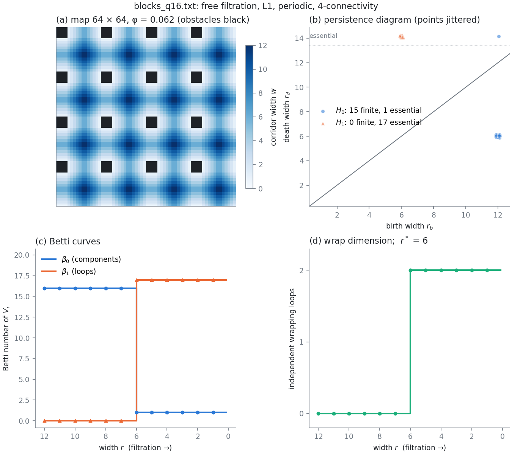
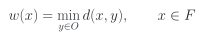
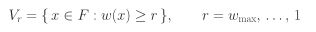
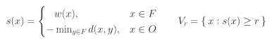
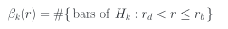
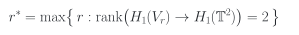
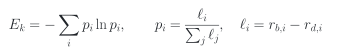
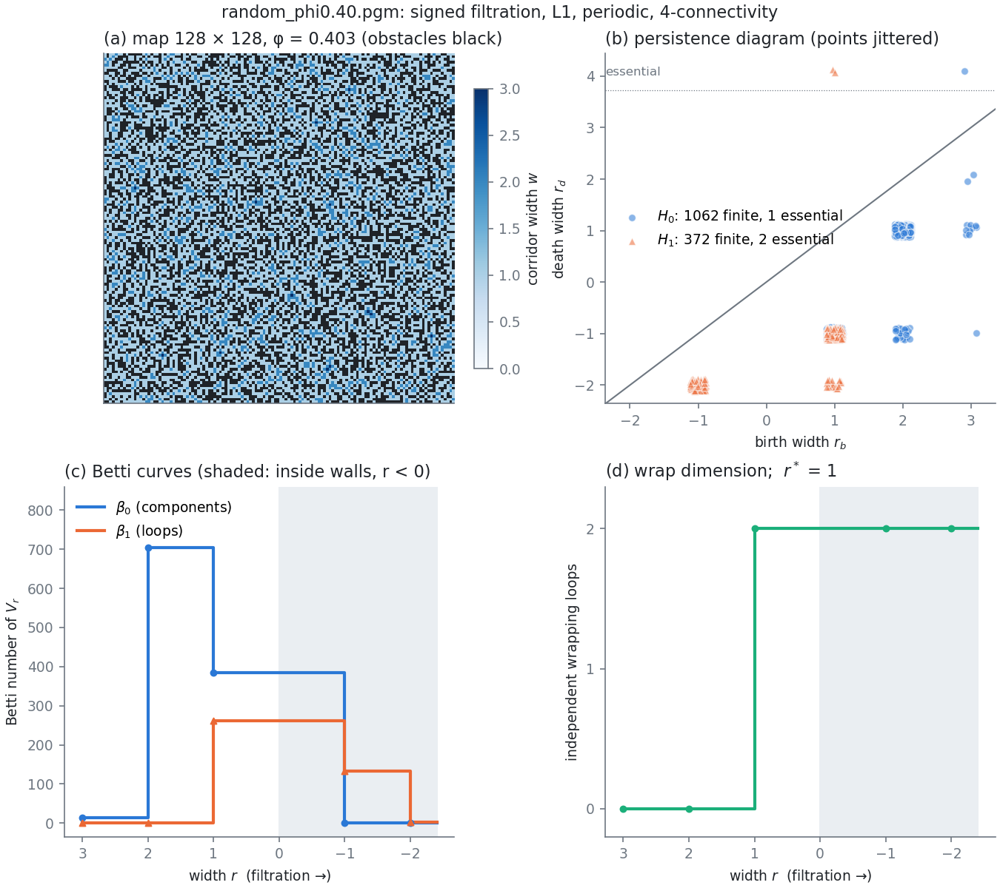
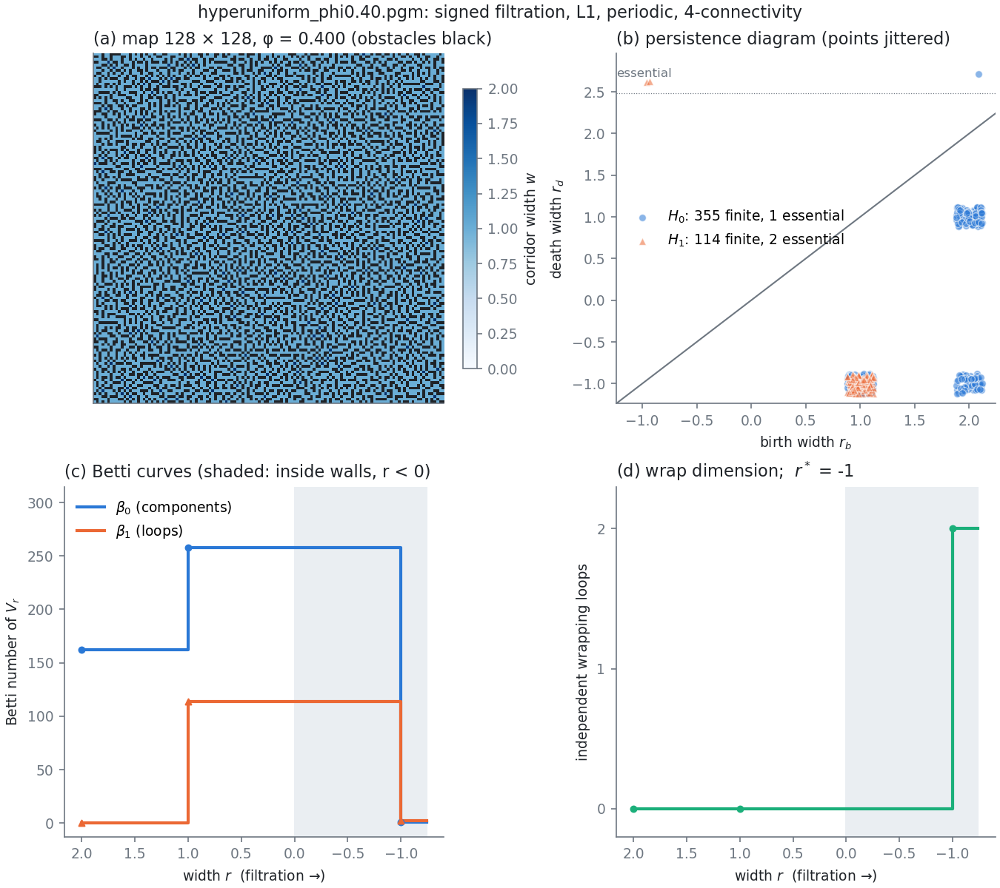
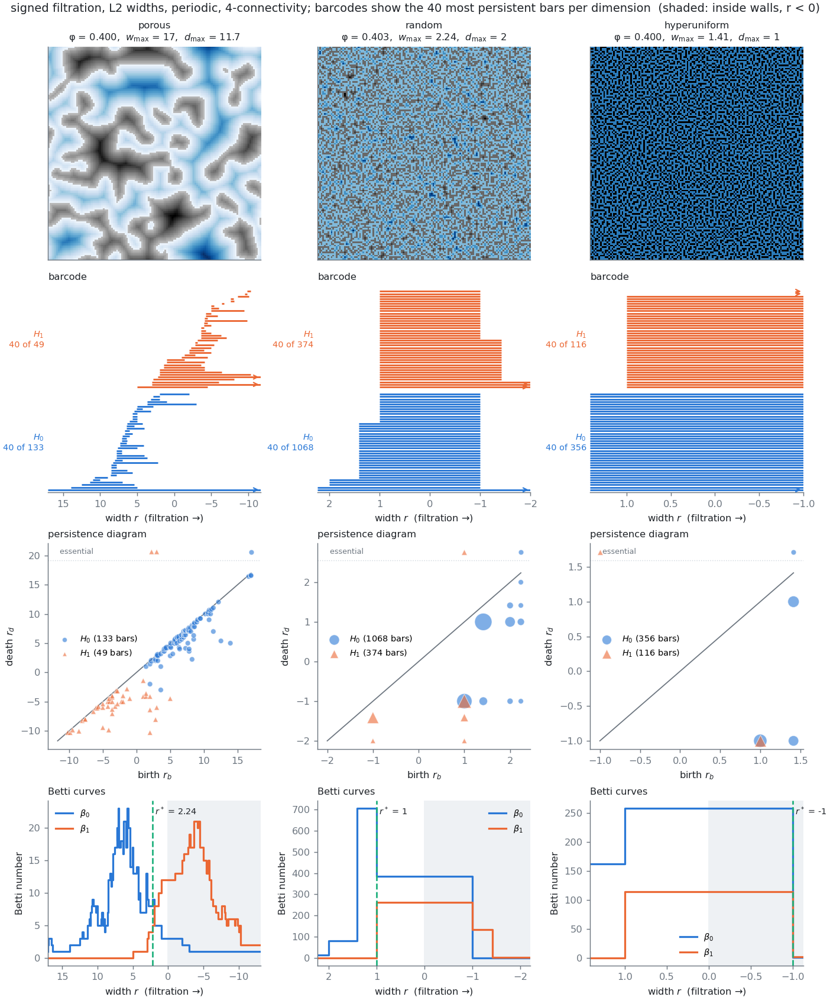

# persistence2D

**Version 0.1.0** — see [CHANGELOG.md](CHANGELOG.md).

Persistent homology of the free space of two-dimensional binary maps

`persistence2D` is a C++20 program built on [GUDHI](https://gudhi.inria.fr). It describes the **shape of the free space** of 2D binary maps: lattices of obstacles and free sites such as porous media, obstacle fields for random walkers, binarized micrographs, or hyperuniform patterns. It filters the free space by **corridor width**, the distance from each free site to the nearest obstacle, and computes the persistent homology of that filtration on a cubical complex, periodic or not:

- **H₀** gives the chambers of the free space and the width of the bottlenecks that join them.
- **H₁** gives the loops around obstacle clusters.
- **Wrapping classes** on the torus tell how wide a corridor has to be for the free space to span the system in one or both directions.

It reads PBM/PGM images, the `.map` files of the chasers simulations and plain text maps. It processes many maps in parallel and writes three CSV files: the persistence intervals, the Betti curves, and one row of descriptors per map. Python helpers read the outputs, vectorize the diagrams and draw summary figures.

<p align="center">
  
</p>
<p align="center"><em><code>examples/blocks_q16.txt</code>: 4 × 4 obstacles every 16 sites on a 64 × 64 torus. (a) Map, free sites shaded by corridor width <i>w</i>. (b) Persistence diagram: the 16 chambers between obstacles are born at width 12 and merge at width 6, the half-width of the channels. (c) Betti curves. (d) The free space wraps around the torus in both directions from <i>r</i>* = 6 on, and then has β₁ = 17 loops: the 16 loops around the obstacles plus the 2 generators of the torus, minus one relation (the 16 obstacle loops add up to zero).</em></p>

## Contents

- [What it computes](#what-it-computes)
- [Requirements](#requirements)
- [Installing GUDHI](#installing-gudhi)
- [Compilation](#compilation)
- [Usage](#usage)
- [Input formats](#input-formats)
- [Outputs](#outputs)
- [Python scripts](#python-scripts)
- [Examples](#examples)
- [Analysis example: three maps at the same density](#analysis-example-three-maps-at-the-same-density)
- [Performance](#performance)
- [Caveats](#caveats)
- [Tests](#tests)
- [Roadmap](#roadmap)
- [References](#references)
- [License](#license)

## What it computes

### Corridor width

A map is a set of sites on an *N*<sub>*x*</sub> × *N*<sub>*y*</sub> lattice, split into obstacles *O* and free sites *F*. The **corridor width** of a free site is its distance to the nearest obstacle:

<p align="center"></p>

The distance *d* is either the **L1** (Manhattan) distance, `metric: l1`, or the **Euclidean** distance, `metric: l2`. L1 is the graph distance of the 4-neighbour lattice and gives integer widths. On a periodic lattice, distances use the minimum image. A free site next to an obstacle has *w* = 1.

Both distance transforms are exact:
- L1 is a breadth-first search from all obstacles.
- L2 is the separable algorithm of Felzenszwalb and Huttenlocher [[1]](#ref-felzenszwalb). On the torus, each line is replicated three times.

### Filtrations

**`filtration: free`** (default) takes the superlevel sets of *w* on the free space:

<p align="center"></p>

As *r* decreases, the free space fills in from the middle of the widest corridors towards the obstacles. At *r* = 1 it is complete.

**`filtration: signed`** continues the filtration into the obstacles. It uses the signed distance, as in the analysis of porous media by Robins *et al.* [[2]](#ref-robins). On an obstacle, *s* is minus the wall thickness, the distance to the nearest free site:

<p align="center"></p>

For *r* ≥ 1 it coincides with `free`. Below that, the obstacles are absorbed from their surface inwards, so separate free regions merge, and the domain wraps around the torus, across walls of thickness −*r*. The last complex is the whole domain.

### Cubical complex and connectivity

The filtration is evaluated on a cubical complex. Persistence is computed with GUDHI's periodic bitmap cubical complexes and persistent cohomology over ℤ₂ [[3]](#ref-gudhi), [[4]](#ref-wagner). Two constructions are available [[5]](#ref-bleile):

- **`connectivity: 4`** (default) is the vertex construction. Sites are the vertices of the complex, a square is present only if its four corners are, and two free sites are connected only through a shared edge. This is the 4-neighbourhood of lattice models: random walks, cluster labelling, site percolation.
- **`connectivity: 8`** is the top-cell construction. Sites are pixels, and two free pixels that touch at a corner are connected. It is the usual choice for images.

The two constructions are dual: 4-connectivity of the free space goes with 8-connectivity of the obstacles, and vice versa [[6]](#ref-kong).

### Persistence intervals

Each interval (bar) of dimension *k* is a homology class of *V*<sub>*r*</sub> that appears at width *r*<sub>*b*</sub> (birth) and disappears at the smaller width *r*<sub>*d*</sub> (death). The persistence of a bar is *r*<sub>*b*</sub> − *r*<sub>*d*</sub> > 0 [[7]](#ref-elz), [[8]](#ref-eh).

- **H₀ bars** are regions of the free space. A region that appears isolated at width *r*<sub>*b*</sub> and merges with an older one at *r*<sub>*d*</sub> is a chamber joined to the rest through a bottleneck of width *r*<sub>*d*</sub>. The set of H₀ bars is a spectrum of chambers and bottlenecks.
- **H₁ bars** are loops of free space around obstacle clusters, that is, independent circulation paths.
- **Essential bars** never die. In `free` mode these are the classes still alive at *r* = 1, the components and loops of the whole free space. In `signed` mode they are the homology of the whole domain.

The **Betti numbers** of *V*<sub>*r*</sub> count the bars alive at *r* (essential bars have *r*<sub>*d*</sub> = −∞):

<p align="center"></p>

### Wrapping and the percolating width

On a periodic lattice, some loops wind around the torus. The domain wraps in a given direction when *V*<sub>*r*</sub> contains such a loop. `persistence2D` finds these loops from the persistence of the whole filtration:
- In `free` mode, the obstacles are appended at a sentinel level after *r* = 1. The intervals are then cut at that level, which gives the persistence of the free space alone.
- The H₁ bars that survive into the whole torus are the classes that wind around it, and there are at most two independent ones.
- The birth of each such bar is the widest corridor at which the domain first wraps in that direction.

The **wrap dimension** of *V*<sub>*r*</sub> (0, 1 or 2) is the number of independent wrapping loops. The **percolating width** *r*\* is the largest width at which the domain wraps in both directions:

<p align="center"></p>

*r*\* is a length, not a density. It is the width of the narrowest point of the widest path that crosses the system both ways, and it can tell apart two maps with the same obstacle fraction. In `signed` mode, *r*\* is always defined on a torus: it is negative when the free space does not wrap and walls of thickness −*r*\* have to be crossed first. *r*<sub>wrap1</sub> is the same quantity for one direction.

### Scalar descriptors

For each dimension, `summary.csv` reports the following over the finite bars:
- the number of bars, and that number per free site;
- the median, 0.9 quantile and maximum persistence;
- the total persistence, the sum of the lengths ℓ<sub>*i*</sub> = *r*<sub>*b*,*i*</sub> − *r*<sub>*d*,*i*</sub>;
- the persistence entropy [[9]](#ref-entropy):

<p align="center"></p>

Quantiles use linear interpolation, as `numpy.quantile` does by default. For a fixed-length vector for statistics or learning, see the persistence images in [`scripts/p2d.py`](#python-scripts) [[10]](#ref-pi).

## Requirements

- A **C++20** compiler, e.g. GCC 11+ or Clang 14+.
- **CMake** 3.20 or newer.
- **GUDHI** 3.10 or newer, C++ headers only. See [Installing GUDHI](#installing-gudhi). Only the cubical-complex and persistent-cohomology modules are used, which are header-only and need no CGAL or Eigen.
- **Boost** headers, which GUDHI needs (Debian/Ubuntu: `libboost-dev`).
- For the scripts: Python 3 with NumPy, plus Matplotlib for the figures. `ctest` runs the Python test when Python is found.
- Only to regenerate the equation images in `docs/eq/`: Matplotlib and LaTeX.

## Installing GUDHI

Debian and Ubuntu do not package the GUDHI C++ library. It is installed from the official repository, at a release tag. The git tree is the developer version: `make user_version` generates the user version, which is what gets installed.

```bash
sudo apt install libboost-dev cmake          # Boost headers and CMake
git clone --depth 1 --branch tags/gudhi-release-3.13.0 --recurse-submodules --shallow-submodules \
    https://github.com/GUDHI/gudhi-devel.git
cd gudhi-devel && mkdir build && cd build
cmake .. -DWITH_GUDHI_THIRD_PARTY=OFF -DUSER_VERSION_DIR=gudhi.3.13.0
make user_version
mkdir install-build && cd install-build
cmake ../gudhi.3.13.0 -DCMAKE_INSTALL_PREFIX=/usr/local -DCMAKE_BUILD_TYPE=Release \
      -DWITH_GUDHI_PYTHON=OFF -DWITH_GUDHI_TEST=OFF -DWITH_GUDHI_EXAMPLE=OFF \
      -DWITH_GUDHI_UTILITIES=OFF -DWITH_GUDHI_GUDHUI=OFF -DWITH_GUDHI_BENCHMARK=OFF
sudo cmake --install .                        # headers to /usr/local/include/gudhi, config to /usr/local/share/gudhi
```

The warnings about CGAL and the CMake policy CMP0167 are harmless. To uninstall:

```bash
sudo xargs rm < install_manifest.txt
```

Without root access, pick another prefix (e.g. `-DCMAKE_INSTALL_PREFIX=$HOME/.local`) and pass `-DGUDHI_DIR=$HOME/.local/share/gudhi` to the CMake configuration of `persistence2D`, or point `-DGUDHI_INCLUDE_DIRS` at any GUDHI `include` directory.

## Compilation

```bash
cmake -S . -B build -DCMAKE_BUILD_TYPE=Release
cmake --build build --parallel
ctest --test-dir build              # unit tests and end-to-end test
```

Options:

| Option | Default | Effect |
|---|---|---|
| `P2D_NATIVE` | `ON` | `-march=native` in Release. Turn it off when the binary is built on one machine and run on others, such as a cluster login node and its compute nodes. |
| `P2D_STATIC` | `OFF` | Link `persistence2D` statically. The binary (about 3 MB) then runs where neither GUDHI, Boost nor a recent libstdc++ is installed. |

A `Debug` build adds AddressSanitizer and UndefinedBehaviorSanitizer:

```bash
cmake -S . -B build-debug -DCMAKE_BUILD_TYPE=Debug
```

## Usage

```bash
./build/persistence2D params.in                     # maps listed in the `input` key
./build/persistence2D params.in maps/*.pgm          # maps on the command line replace `input`
./build/persistence2D --help
./build/persistence2D --version
```

The parameter file has one `key: value` per line, and `#` starts a comment. Unknown or repeated keys are errors. [`params.in`](params.in) documents every key:

| Key | Values | Default | Meaning |
|---|---|---|---|
| `input` | file names, space-separated | — | Maps to analyse. The command line overrides it. |
| `obstacle` | `dark`, `light` | `dark` | Which pixels of PBM/PGM images are obstacles. |
| `filtration` | `free`, `signed` | `free` | Free space only, or continued into the obstacles. |
| `metric` | `l1`, `l2` | `l1` | Distance for *w* (and for the wall thickness). |
| `periodic` | `true`, `false` | `true` | Torus, or open box. |
| `boundary_obstacle` | `true`, `false` | `false` | Open box only: the sites just outside the lattice count as obstacles. |
| `connectivity` | `4`, `8` | `4` | Vertex or top-cell construction (see above). |
| `num_threads` | integer ≥ 0 | `0` | Maps processed in parallel; `0` = all CPUs available to the process, which respects the affinity set by Slurm. |
| `bars_file`, `betti_file`, `summary_file` | path, or empty | `bars.csv`, `betti.csv`, `summary.csv` | Outputs. An empty value skips the file, and directories are created. |

The program prints one line per run. A map that cannot be read or analysed does not stop the others: its row in `summary.csv` carries the error message, and the exit code is 1. A bad parameter file gives exit code 2.

## Input formats

The format is detected from the content of the file, not from its extension.

| Format | Detected by | Obstacles |
|---|---|---|
| PBM, plain (`P1`) or raw (`P4`) | magic number | bit 1 (black) if `obstacle: dark`, bit 0 if `light` |
| PGM, plain (`P2`) or raw (`P5`), 8 or 16 bit | magic number | value *v* with 2*v* ≤ maxval (dark) if `obstacle: dark`, otherwise the light ones |
| chasers map | first line `# chasers-map` | `#` (free `.`); `key: value` header up to `---`, checked against the `L` and `n_obs` keys |
| text | anything else | `#` or `1` (free `.` or `0`); whitespace ignored, lines starting with `%` are comments |

Row *y* = 0 is the first row of the file, the top of the image. The site (*x*, *y*) has flat index *x* + *N*<sub>*x*</sub>*y*. Rectangular maps are allowed.

[hyperuniform2D](https://github.com/manuxch/hyperuniform2D) writes occupied sites as 1 (white) in a plain PGM. If its occupied sites are the obstacles, use `obstacle: light`.

## Outputs

Every CSV file starts with two `#` lines, the program version with a description and the options used, followed by a header row. `pandas.read_csv(path, comment="#")` reads them, and so do the helpers in `scripts/p2d.py`. Missing values are `nan`, infinite deaths are `inf`.

**`bars.csv`**: one row per persistence interval.

| Column | Meaning |
|---|---|
| `file` | map file, as given |
| `dim` | homology dimension: 0, 1, or 2 (the top class of a domain with no obstacle left) |
| `birth`, `death` | widths *r*<sub>*b*</sub> > *r*<sub>*d*</sub>; `death = inf` for essential classes |
| `persistence` | *r*<sub>*b*</sub> − *r*<sub>*d*</sub>; `inf` for essential classes |
| `essential` | 1 if the class never dies (in the free space for `free`, in the whole domain for `signed`) |
| `wraps` | 1 for H₁ classes that wind around the torus |

**`betti.csv`**: the Betti curves, with one row per distinct width *r* of the filtration, decreasing.

| Column | Meaning |
|---|---|
| `file`, `r` | map and width |
| `beta0`, `beta1` | Betti numbers of *V*<sub>*r*</sub> |
| `wraps` | wrap dimension of *V*<sub>*r*</sub>: 0, 1 or 2 |

**`summary.csv`**: one row per map.

| Column | Meaning |
|---|---|
| `file`, `format`, `nx`, `ny` | map, detected format, size |
| `n_free`, `phi` | free sites; obstacle fraction |
| `w_max`, `w_mean` | widest free site; mean corridor width over the free space |
| `d_max` | thickest wall (`signed` only, 0 otherwise) |
| `beta0`, `beta1` | components and loops of the whole free space (*r* = 1) |
| `wrap_dim` | wrap dimension of the whole free space |
| `r_wrap1`, `r_star` | width at which the domain first wraps in one direction and in both (*r*\*); `nan` if it never does |
| `branching` | `beta1 / n_free`: independent loops per free site |
| `h0_n`, `h0_essential`, `h0_per_free` | finite and essential H₀ bars; finite ones per free site |
| `h0_pers_median`, `h0_pers_q90`, `h0_pers_max` | statistics of the finite H₀ persistences |
| `h0_total`, `h0_entropy` | total persistence and persistence entropy of the finite H₀ bars |
| `h1_*` | the same for H₁ |
| `error` | empty, or why the map could not be analysed |

The distance field itself is not written. It is cheap to recompute: `scripts/plot_persistence.py` does it for display.

## Python scripts

**[`scripts/p2d.py`](scripts/p2d.py)** is a small module that needs only NumPy:

```python
import sys; sys.path.insert(0, "scripts"); import p2d

grid = p2d.read_map("examples/hyperuniform_phi0.40.pgm", obstacle="light")  # bool [y, x], True = obstacle
bars = p2d.read_bars("results/bars.csv")             # {file: Bars}
b = bars["examples/random_phi0.40.pgm"]
b.diagram(0)                                         # (n, 2) finite (birth, death) pairs of H0
b.diagram(1, essential=True)                         # essential H1 classes (death = inf)
curves = p2d.read_betti("results/betti.csv")         # {file: {"r", "beta0", "beta1", "wraps"}}
rows = p2d.read_summary("results/summary.csv")       # list of dicts
img = p2d.persistence_image(b.diagram(0), p2d.image_grid(1, 4, 0, 3, 20), sigma=0.25)
```

`persistence_image` follows Adams *et al.* [[10]](#ref-pi):
- each finite pair is mapped to (birth, persistence) and spread with a Gaussian of width σ;
- the Gaussians are weighted linearly by persistence;
- the result is sampled at the pixel centres of the grid.

Persistence images computed on a common grid can be compared across maps or fed to a regression.

**[`scripts/plot_persistence.py`](scripts/plot_persistence.py)** runs `persistence2D` on one map and draws the four-panel figure shown above: the map, the persistence diagram, the Betti curves and the wrap dimension.

```bash
python3 scripts/plot_persistence.py examples/random_phi0.40.pgm --filtration signed --out random.png
python3 scripts/plot_persistence.py map.pgm --obstacle light --metric l2 --open --connectivity 8
```

**[`scripts/compare_maps.py`](scripts/compare_maps.py)** runs `persistence2D` on several maps and draws them side by side. Each column shows a map, its barcode (the most persistent bars), its persistence diagram (marker area proportional to multiplicity) and its Betti curves. See the [analysis example](#analysis-example-three-maps-at-the-same-density).

**[`scripts/make_examples.py`](scripts/make_examples.py)** regenerates the deterministic example maps.

`p2d.width_field(obstacle, periodic, metric, signed)` recomputes the width field in Python, for display.

## Examples

[`examples/`](examples) contains five maps and parameter files for them:

| File | Map |
|---|---|
| `blocks_q16.txt` | 64 × 64, 4 × 4 obstacles every 16 sites (text format) |
| `channels.map` | 48 × 48 chasers map: two horizontal walls, 3 sites thick, one with a 2-site gap |
| `random_phi0.40.pgm` | 128 × 128, independent obstacles with probability 0.40 (plain PGM, obstacles black) |
| `porous_phi0.40.pgm` | 128 × 128 porous medium: a periodic Gaussian random field with correlation length 4, thresholded at obstacle fraction 0.40 (obstacles black) |
| `hyperuniform_phi0.40.pgm` | 128 × 128 stealthy hyperuniform pattern, density 0.40, χ = 0.3, from hyperuniform2D with [`hyperuniform_phi0.40.hyper2D.in`](examples/hyperuniform_phi0.40.hyper2D.in) (obstacles white) |

```bash
./build/persistence2D params.in                     # blocks, channels and random; free filtration
./build/persistence2D examples/random.in            # random, signed filtration
./build/persistence2D examples/hyperuniform.in      # hyperuniform, signed filtration, obstacle: light
./build/persistence2D examples/open_box.in          # open boundary, frame as obstacle, L2, 8-connectivity
```

The results go to `results/`. Some values the tests check:
- **Blocks:** β₀ = 1 and β₁ = 17, wrapping in both directions at *r*\* = 6, half the 12-site channel.
- **Channels:** the free space wraps horizontally at *r*<sub>wrap1</sub> = 11, the half-width of each band, and never vertically: *r*\* is `nan` in `free` mode. In `signed` mode *r*\* = −2, because the vertical wrap has to cross the middle of a 3-site wall.

The random and hyperuniform maps have the same obstacle fraction but a different free space (`signed` filtration, L1, periodic, 4-connectivity):

| | random | hyperuniform |
|---|---|---|
| obstacle fraction φ | 0.403 | 0.400 |
| widest free site *w*<sub>max</sub>, mean width | 3, 1.12 | 2, 1.02 |
| thickest wall *d*<sub>max</sub> | 2 | 1 |
| components β₀, loops β₁ of the free space | 384, 261 | 258, 114 |
| wrap dimension of the free space | 2 | 0 |
| percolating width *r*\* | 1 | −1 |

The free space of the random map percolates in both directions. The hyperuniform one does not: its 258 components are separated by walls one site thick.

<p align="center">
  &nbsp;
</p>
<p align="center"><em>Random (left) and hyperuniform (right) examples, signed filtration. The shaded part of the curves is inside the walls (r &lt; 0).</em></p>

## Analysis example: three maps at the same density

[`scripts/compare_maps.py`](scripts/compare_maps.py) analyses several maps with the same options and puts them side by side:

```bash
python3 scripts/compare_maps.py examples/porous_phi0.40.pgm::porous examples/random_phi0.40.pgm::random \
    examples/hyperuniform_phi0.40.pgm:light:hyperuniform --out docs/figures/comparison.png
```

The figure below compares three maps with the same obstacle fraction, 0.40. The options are the `signed` filtration, Euclidean widths, periodic boundaries and 4-connectivity. Each column has four rows:
1. The map, with free sites in blue (darker = wider corridor) and obstacles in grey (darker = thicker wall).
2. The barcode of the 40 most persistent bars of each dimension. Arrows mark essential classes.
3. The persistence diagram. The marker area grows with the number of bars at the same point.
4. The Betti curves, with the percolating width *r*\* marked.

<p align="center">
  
</p>

**Porous medium.** Its structure spans many widths, and the diagram spreads over the whole range:
- **Chambers (H₀).** Corridors up to *w* = 17 wide. As *r* decreases, H₀ bars are born at the centres of the chambers, at widths between 5 and 17. Most die soon after, close to the diagonal: those chambers are joined to their neighbours by throats almost as wide as themselves. The few points far below the diagonal are chambers behind narrow throats. For example, a point at (14, 5) is a chamber 14 wide whose exit is 5 wide.
- **Percolation.** The free space wraps around the torus in both directions at *r*\* = 2.24. A walker that needs corridors wider than that cannot cross the system.
- **Loops (H₁).** The H₁ bars are born in the free space (*r*<sub>*b*</sub> > 0) and die inside the walls (*r*<sub>*d*</sub> < 0). A loop closes around an obstacle cluster at width *r*<sub>*b*</sub>. It is filled when the filtration absorbs that cluster, at minus its half-thickness, so the depth of a point below zero measures the size of the enclosed obstacle.

**Random map.** Everything happens at the lattice scale:
- No corridor is wider than √5 ≈ 2.24, and no wall is thicker than 2.
- The diagram collapses onto a few points with large multiplicity: about 1068 H₀ bars, most of them born at *r* = 1 or √2 and dying at *r* = 1 or −1.
- The free space still wraps in both directions at *r*\* = 1, so it percolates.

**Hyperuniform map.** The suppression of density fluctuations removes both open regions and thick obstacle clusters:
- No free site is farther than √2 from an obstacle, and no wall is thicker than 1.
- Nearly all bars fall on two points of the diagram.
- The 258 components of the free space do not connect across the torus: *r*\* = −1, so walls one site thick have to be crossed before the domain wraps. Below the percolation threshold at the same obstacle fraction, the free space is more fragmented than the random one.

In maps like the last two, with structure at the scale of one lattice spacing, the informative quantities are the Betti numbers and the wrap dimension at *r* = 1 (see [Caveats](#caveats)).

## Performance

Measurements are on one core of a Ryzen 5 5600X, with obstacle fraction 0.4, `signed` filtration and L1 distance. The `free` filtration takes about the same time.

| Map | Time per map | Memory |
|---|---|---|
| 120 × 120 | 14 ms | — |
| 240 × 240 | 60 ms | 26 MB |
| 512 × 512 | 0.32 s | 110 MB |
| 1024 × 1024 | 1.4 s | 430 MB |

Maps are processed in parallel. 200 maps of 120 × 120 take 2.7 s on one thread and 0.4 s on the 12 threads of the same machine.

## Caveats

- **Thin structures give few levels.** The width filtration resolves shapes wider than a few lattice spacings. Near the percolation threshold of a dense obstacle lattice, almost every free site touches an obstacle and almost every wall is one site thick. The filtration then has only two or three levels, and the information is in the topology at *r* = 1 (β₀, β₁, wrap dimension) rather than in the persistence. See [Roadmap](#roadmap) for filtrations that resolve smaller scales.
- **L1 widths are integers**, so many bars share the same birth and death. Use `metric: l2` for finer levels; the topology at *r* = 1 does not depend on the metric.
- **`signed` mode has a gap at zero.** Free widths are ≥ 1 and wall thicknesses are ≥ 1, so there is no level *r* = 0. A bar that dies inside a wall of thickness *d* has persistence *r*<sub>*b*</sub> + *d*. Crossing the thinnest wall, from *r* = 1 to *r* = −1, already adds 2.
- **Open boundaries** have no wrapping classes, so *r*\* and *r*<sub>wrap1</sub> are `nan`. Use `boundary_obstacle: true` when the frame of the image is a physical wall. Without it, the free space near the frame is as wide as its distance to the nearest obstacle inside the image.
- **The top dimension.** GUDHI's persistent cohomology skips the top dimension of the complex unless asked. `persistence2D` asks, so that the whole torus has β = (1, 2, 1).

## Tests

`ctest --test-dir build` runs two suites.

`tests/test_persistence2D.cpp` holds the unit tests:
- **Hand-computable topology:** empty torus β = (1, 2, 1), open square β = (1, 0, 0), punctured torus with *r*\* = *L*/2, the blocks pattern (β₁ = blocks + 1, *r*\* = half the channel), a wall with *r*\* = −2, and a checkerboard that separates 4- from 8-connectivity.
- **Euler characteristic:** at every level of 288 random maps, χ(*V*<sub>*r*</sub>) counted cell by cell (vertices − edges + squares) equals β₀ − β₁ + β₂ from the bars. This covers both metrics, both boundary conditions, both connectivities and both filtrations.
- **Signed versus free:** the two filtrations agree for *r* ≥ 1.
- **Distances:** both transforms against brute force, periodic, open and with a boundary obstacle.
- **Readers:** every input format reads the same map, a `.map` and its PGM give identical diagrams, and malformed headers and parameter files are rejected.

`tests/test_cli.py` is the end-to-end test of the executable and the Python scripts:
- the values of the examples above;
- error handling and exit codes;
- `obstacle: light`;
- the readers and figure script in `scripts/`.

## Roadmap

- **Smoothed-field filtration:** superlevel sets of the local obstacle density averaged with a kernel of width σ, to resolve shape at scales of a few sites where the width filtration has too few levels.
- **User-provided scalar fields:** sublevel or superlevel persistence of any field given on the lattice.
- **Component and loop statistics at *r* = 1:** size distributions of the free clusters and of the loops.
- **Point-pattern persistence:** Rips or alpha complexes on obstacle positions, the usual tool for hyperuniform point patterns.
- **Three-dimensional maps.**

## References

1. <a id="ref-felzenszwalb"></a>P. F. Felzenszwalb and D. P. Huttenlocher, *Distance transforms of sampled functions*, Theory of Computing **8**, 415–428 (2012). [doi:10.4086/toc.2012.v008a019](https://doi.org/10.4086/toc.2012.v008a019)
2. <a id="ref-robins"></a>V. Robins, M. Saadatfar, O. Delgado-Friedrichs and A. P. Sheppard, *Percolating length scales from topological persistence analysis of micro-CT images of porous materials*, Water Resources Research **52**, 315–329 (2016). [doi:10.1002/2015WR017937](https://doi.org/10.1002/2015WR017937)
3. <a id="ref-gudhi"></a>C. Maria, J.-D. Boissonnat, M. Glisse and M. Yvinec, *The Gudhi library: simplicial complexes and persistent homology*, in *Mathematical Software – ICMS 2014*, Lecture Notes in Computer Science **8592**, 167–174 (Springer, 2014). [doi:10.1007/978-3-662-44199-2_28](https://doi.org/10.1007/978-3-662-44199-2_28). The GUDHI Project, *GUDHI User and Reference Manual*, https://gudhi.inria.fr/doc/latest/
4. <a id="ref-wagner"></a>H. Wagner, C. Chen and E. Vuçini, *Efficient computation of persistent homology for cubical data*, in *Topological Methods in Data Analysis and Visualization II*, Mathematics and Visualization, 91–106 (Springer, 2012). [doi:10.1007/978-3-642-23175-9_7](https://doi.org/10.1007/978-3-642-23175-9_7)
5. <a id="ref-bleile"></a>B. Bleile, A. Garin, T. Heiss, K. Maggs and V. Robins, *The persistent homology of dual digital image constructions*, in *Research in Computational Topology 2*, Association for Women in Mathematics Series, 1–26 (Springer, 2022). [doi:10.1007/978-3-030-95519-9_1](https://doi.org/10.1007/978-3-030-95519-9_1)
6. <a id="ref-kong"></a>T. Y. Kong and A. Rosenfeld, *Digital topology: introduction and survey*, Computer Vision, Graphics, and Image Processing **48**, 357–393 (1989). [doi:10.1016/0734-189X(89)90147-3](https://doi.org/10.1016/0734-189X(89)90147-3)
7. <a id="ref-elz"></a>H. Edelsbrunner, D. Letscher and A. Zomorodian, *Topological persistence and simplification*, Discrete & Computational Geometry **28**, 511–533 (2002). [doi:10.1007/s00454-002-2885-2](https://doi.org/10.1007/s00454-002-2885-2)
8. <a id="ref-eh"></a>H. Edelsbrunner and J. Harer, *Computational Topology: An Introduction* (American Mathematical Society, 2010). [doi:10.1090/mbk/069](https://doi.org/10.1090/mbk/069)
9. <a id="ref-entropy"></a>H. Chintakunta, T. Gentimis, R. Gonzalez-Diaz, M.-J. Jimenez and H. Krim, *An entropy-based persistence barcode*, Pattern Recognition **48**, 391–401 (2015). [doi:10.1016/j.patcog.2014.06.023](https://doi.org/10.1016/j.patcog.2014.06.023)
10. <a id="ref-pi"></a>H. Adams, T. Emerson, M. Kirby, R. Neville, C. Peterson, P. Shipman, S. Chepushtanova, E. Hanson, F. Motta and L. Ziegelmeier, *Persistence images: a stable vector representation of persistent homology*, Journal of Machine Learning Research **18**(8), 1–35 (2017). https://jmlr.org/papers/v18/16-337.html
11. <a id="ref-otter"></a>N. Otter, M. A. Porter, U. Tillmann, P. Grindrod and H. A. Harrington, *A roadmap for the computation of persistent homology*, EPJ Data Science **6**, 17 (2017). [doi:10.1140/epjds/s13688-017-0109-5](https://doi.org/10.1140/epjds/s13688-017-0109-5). A practical introduction to the field and its software.

## License

[MIT](LICENSE). GUDHI is distributed under the MIT license. Some GUDHI modules depend on CGAL, which is GPL-licensed. `persistence2D` uses none of them.
